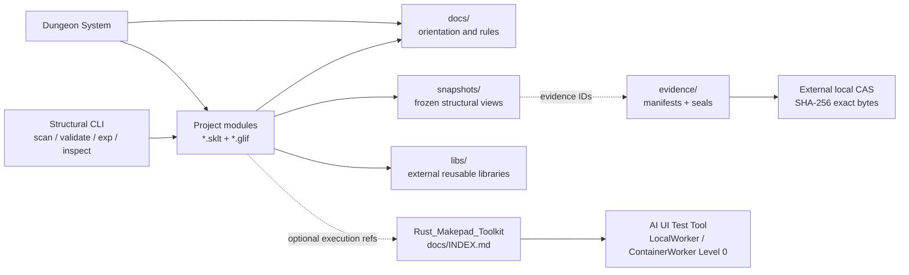

# Project map

Карта отражает structural layer и его внешнюю execution boundary. Конкретные project modules появляются после добавления `.sklt` в верхнеуровневые области проекта.

Dungeon System фиксирует **what / where / structure**. Toolkit выполняет **how / execution capability**. Внутренности Toolkit, его container runtime и image lifecycle не являются частью этой карты.

Git хранит SKLT/GLIF, snapshots, Cronica и небольшие Evidence Manifests. Evidence ссылается на immutable CAS bytes; runtime payloads не копируются в `snapshots/`.
